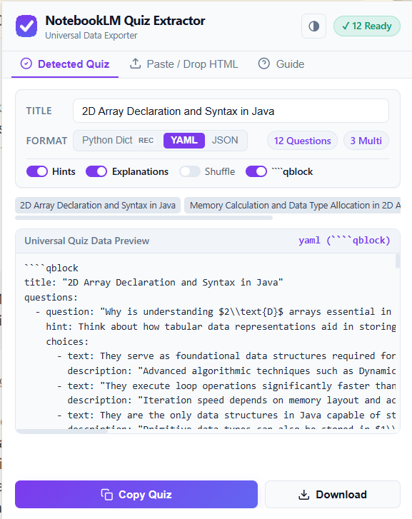

# 📚 NotebookLM Quiz Extractor

A fast 1-click browser extension developed by **[SSKhekhaliya](https://www.sskhekhaliya.in/)** to extract quizzes from **Google NotebookLM** into clean, universal **YAML**, **Python Dict**, or **JSON**. Features instant in-page copying, nested code-block protection, and optional export for the **[Obsidian Quiz Block](https://github.com/sskhekhaliya/obsidian-quiz-block)** plugin.

[](https://buymeacoffee.com/sskhekhaliya)

<p align="center">
  
</p>

---

## ✨ Features

- **⚡ Instant 1-Click Extraction**: Automatically detects when a quiz is active in Google NotebookLM (even across sandboxed `scf.usercontent.goog` iframes).
- **🌐 Universal Clean Formats (No Code Fences by Default)**:
  - Outputs pure, clean, ready-to-use **YAML**, **Python Dict**, or **JSON**.
  - Perfect for importing into Anki, Quizlet, custom learning scripts, database ingestion, or note-taking apps.
  - Optional toggle: **`[ ] ````qblock`** flips on Obsidian Quiz Block markdown wrapping when you want to embed directly in Obsidian notes.
  - **Adaptive Fence Guard**: Automatically detects nested code blocks (like ` ```java `) and uses 4 backticks (` ````qblock `) so code snippets never prematurely close the block in Obsidian.
- **🎨 System Adaptive Theme (Light / Dark)**:
  - Automatically matches your operating system / browser theme (clean white in Light mode, deep Obsidian dark in Dark mode).
  - Quick header button allows switching between **Auto (System) ➔ Light ➔ Dark**.
- **🎯 In-Page Floating Pill**: Injects an unobtrusive floating `[ 📝 Copy Quiz (12 Qs) ]` button right inside Google NotebookLM for instant clipboard copying.
- **📥 Drag & Drop / Offline Fallback**: Drag and drop saved `.html` files (e.g. `google notebook quize.html`) or paste raw data directly into the popup.
- **💾 One-Click Download**: Automatically saves files with the appropriate extension (`.yaml`, `.py`, `.json`, or `.md` when fence is enabled).

---

## 🚀 How to Install in Your Browser

1. Open your browser's extensions page:
   - **Chrome**: `chrome://extensions`
   - **Edge**: `edge://extensions`
   - **Brave**: `brave://extensions`
2. Turn ON **Developer mode** (top-right corner).
3. Click **Load unpacked** (or click Reload if already loaded).
4. Select this directory:
   ```
   d:\Projects\Browser Extensions\notebook-quiz-extractor
   ```
5. Pin the extension to your toolbar.

---

## 🧩 Obsidian Plugin Integration

To render extracted quizzes as interactive cards in your vault:
- Install the **[Obsidian Quiz Block Plugin](https://github.com/sskhekhaliya/obsidian-quiz-block)**.
- Enable the **`[ ] ````qblock`** toggle in the extension popup.
- Paste the result into any Obsidian note.
- Supports single-choice radio buttons, multi-select checkboxes, hints, option explanations, dynamic scoring, review mode, retake, and shuffle!

---

## ☕ Support

If you find **NotebookLM Quiz Extractor** helpful for your studies and workflows, consider supporting the development:

[](https://buymeacoffee.com/sskhekhaliya)

---

## 📄 License & Credits

- **Author**: [SSKhekhaliya](https://www.sskhekhaliya.in/)
- **Support**: [buymeacoffee.com/sskhekhaliya](https://buymeacoffee.com/sskhekhaliya)
- **Obsidian Companion Plugin**: [Obsidian Quiz Block](https://github.com/sskhekhaliya/obsidian-quiz-block)
